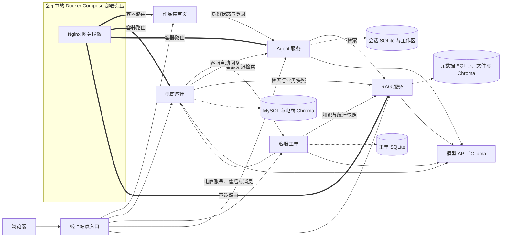
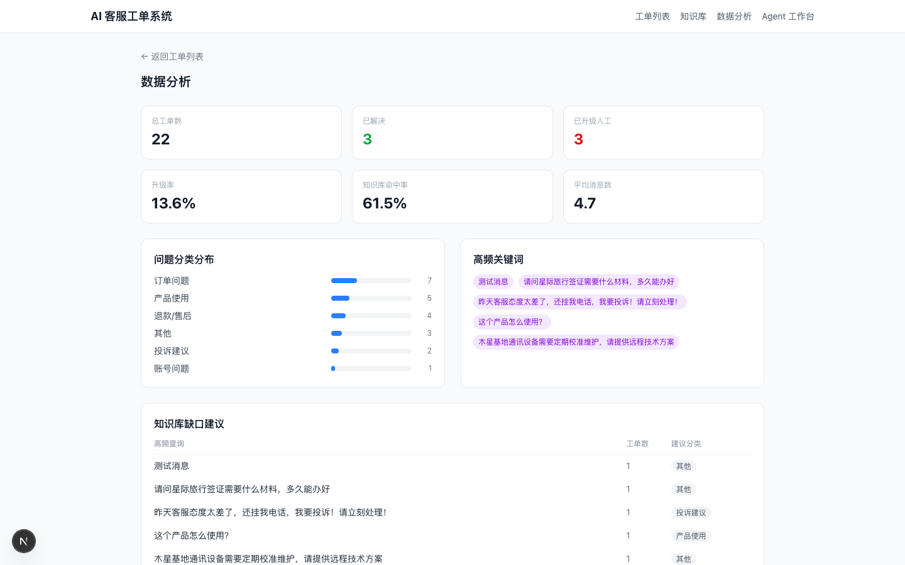

# AI 全栈应用与智能体实践

**one-project** 包含电商业务管理与智能分析、客服工单、Agent 控制台和 RAG 知识库。四个应用各有操作界面，通过 HTTP 接口协作。买家可在商城发起咨询，运营人员在客服工作台接管，电商助手可以检索电商和客服同步到 RAG 的知识快照。

[打开线上作品集首页](https://www.yuganwinfurt.top/) · [本地开发与运行](docs/LOCAL_DEVELOPMENT.md) · [文档索引](docs/README.md)

## 在线演示

| 应用 | 可以体验的功能 | 技术栈 | 线上入口 | 源码 |
| --- | --- | --- | --- | --- |
| 电商业务管理与智能分析平台 | 浏览商城、管理订单和售后，用自然语言查询运营数据 | Vue 3、Vite、Element Plus、FastAPI、SQLAlchemy、MySQL、LangGraph、MCP | [电商平台](https://www.yuganwinfurt.top/ecommerce/) | [前端](customer-service-system/frontend/) · [后端](customer-service-system/backend/) |
| 智能客服工单系统 | 在工作台查看工单、接管会话、检索知识和生成回复 | Next.js、React、TypeScript、FastAPI、SQLAlchemy、SQLite、SSE | [客服工作台](https://www.yuganwinfurt.top/support/) | [前端](ai-customer-service-agent/frontend/) · [后端](ai-customer-service-agent/backend/) |
| Agent 控制台 | 切换模型、管理会话和工作区、查看工具调用 | FastAPI、原生 JavaScript、SQLite、OpenAI 兼容接口／Anthropic／Ollama | [Agent 控制台](https://www.yuganwinfurt.top/agent/) | [Agent 应用源码](yugan-agent/src/yugan_agent/) |
| RAG 知识库 | 导入文档、限定知识库范围检索、查看问答引用 | Vue 3、Vite、FastAPI、LangChain、LangGraph、Chroma、SQLite、Ollama | [RAG 知识库](https://www.yuganwinfurt.top/rag/) | [前端](rag-assistant/frontend/) · [后端](rag-assistant/backend/) |

客服工作台使用电商管理员或运营账号登录。各应用的管理、写入和模型功能随登录角色及模型配置而变化。

## 系统架构



实线表示 HTTP 或页面访问，虚线表示应用使用的存储，粗线表示仓库 Nginx 模板中的容器路由。模型调用取决于应用配置。线上客服有独立入口，仓库中的 Compose 未定义客服容器或 `/support/` 路由。部署边界和浏览器侧调用见[架构说明](docs/ARCHITECTURE.md)。

## 核心功能与工程设计

- **电商业务与问数**。商城和运营端覆盖商品、库存、订单、评价与售后。LangGraph 编排查询、证据整理和报告决策，电商后端通过 stdio MCP 工具读取 MySQL、Chroma 和运行记录。SQLGlot 校验表与字段范围，限制查询结构和返回行数。部分业务动作先形成待确认方案，再按用户和会话恢复执行。[图编排](customer-service-system/backend/app/agent/graph.py) · [SQL 校验](customer-service-system/backend/app/services/nl2sql/validate.py) · [确认恢复](customer-service-system/backend/app/services/confirmation_service.py)
- **客服与人工接管**。客服工作台同步电商咨询和售后状态。客服本地知识查询按关键词评分，工单流程可结合向量检索并提供 SSE 流式回复接口。商城自动回复由电商后台任务调度，调用 Agent 的共享客服模型。会话转人工、关闭或收到更新消息后，旧回复任务不能继续写入。[工单路由](ai-customer-service-agent/backend/main.py) · [电商同步](ai-customer-service-agent/backend/services/ecommerce_integration.py) · [自动回复任务](customer-service-system/backend/app/services/customer_support_service.py)
- **模型与工具运行**。Agent 管理会话、工作区和模型配置，执行多步工具任务并记录执行结果。工具执行经过参数、工作区与审批逻辑。共享客服模型接口校验本机调用和服务令牌，电商后端在部分连接失败场景可使用自己的模型配置。[Agent 循环](yugan-agent/src/yugan_agent/agent.py) · [工具注册表](yugan-agent/src/yugan_agent/tools.py) · [客服模型接口](yugan-agent/src/yugan_agent/support_models.py)
- **可追溯检索**。RAG 导入 PDF、DOCX、TXT、Markdown 和 CSV，按知识库切分并通过 Ollama 生成向量，使用 Chroma 持久化。问答支持查询改写、限定知识库范围和返回来源。电商和客服可手动同步业务快照，索引更新时复用内容与模型标识均匹配的向量。[解析与索引](rag-assistant/backend/app/rag/pipeline.py) · [问答图](rag-assistant/backend/app/rag/graph.py) · [快照索引](rag-assistant/backend/app/rag/ecommerce_index.py)

## 源码目录

```text
one-project/
├── customer-service-system/     # 电商 Vue 前端、FastAPI 后端、SQL 与测试
├── ai-customer-service-agent/   # 客服 Next.js 前端、FastAPI 后端与截图
├── yugan-agent/                 # 当前应用在 src/yugan_agent/，另有保留的上游代码
├── rag-assistant/               # RAG 前后端、检索测试与资料导入目录
├── project-hub/                 # Vue 首页、身份代理与部署模板
├── docker/                      # Dockerfile、Nginx 网关和镜像发布脚本
├── .github/workflows/           # Docker Hub 镜像发布流程
├── compose.yaml                 # 现有容器编排
├── compose.publish.yaml         # 镜像发布与拉取覆盖配置
├── local_projects_gui.py        # Windows 本机启动器界面
├── local_admin_*.py             # Windows 本机账号管理辅助脚本
└── docs/                        # 架构、开发、审查报告与文档索引
```

后端使用 FastAPI／Uvicorn，电商与客服用 SQLAlchemy，Agent 与 RAG 各自维护 SQLite。容器构建和发布使用 Docker Compose、Nginx 与 GitHub Actions。仓库提供 pytest、Node 原生测试和客服 HTTP 冒烟脚本。模块入口、运行检查和已知基线问题分别见[本地开发](docs/LOCAL_DEVELOPMENT.md)和[代码质量报告](docs/CODE_QUALITY_REPORT.md)。

## 本地运行

建议使用 Python 3.12+、Node.js 22.18+（22 系列）或 24.12+、npm、MySQL 与 Ollama。在本机测试库按[本地开发文档](docs/LOCAL_DEVELOPMENT.md)分别启动前后端。端口、示例环境文件及跨服务令牌配对都在该文档中。

容器配置的服务范围、当前电商路径问题与发布入口见[Docker 说明](DOCKER.md)。需要调整部署文件时，先参考[代码质量报告](docs/CODE_QUALITY_REPORT.md)中的验证和回滚方案。

## 界面截图

客服工作台历史截图，展示数据分析页的布局。


