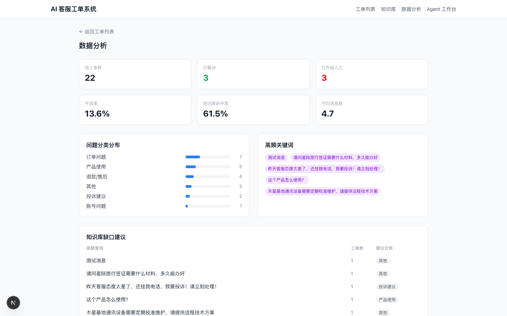

# 智能客服工单系统

客服工作台面向电商售后与买家咨询。使用电商管理员或运营账号登录后，可查看工单、进行 AI 分析、人工接管或回复。工单支持分类、优先级、知识条目、总结及统计。[线上工作台](https://www.yuganwinfurt.top/support/) · [项目总览](../README.md)

| 目录 | 技术与职责 |
| --- | --- |
| [backend/](backend/) | FastAPI、SQLAlchemy、SQLite，提供工单、账号、回复和集成接口 |
| [frontend/](frontend/) | Next.js、React、TypeScript、Tailwind CSS，提供工单、知识与分析页面 |

## 回复和知识流程

- 工单工作流提供 SSE 回复，检索可结合关键词和向量。独立的客服知识接口使用关键词评分，供商城自动回复准备上下文。 [工单流程](backend/main.py#L743) · [流式回复](backend/main.py#L1026) · [知识查询](backend/services/knowledge_base.py)
- 商城自动回复由电商后台任务调用 Agent。客服工作台也可使用 Agent 所选模型生成回复，校验会话状态后保存并同步。 [工作台模型桥接](backend/services/agent_model_bridge.py) · [电商同步](backend/services/ecommerce_integration.py)
- 启用的知识条目和客服统计可同步到独立 RAG 库。 [RAG 接入](backend/services/rag_integration.py)

## 本地运行

按[本地开发文档](../docs/LOCAL_DEVELOPMENT.md#客服工单)先启动电商 API，再启动客服 API 和 Next.js。默认前端端口为 `3000`，后端端口为 `8002`。服务间令牌和账号配置见[配置配对](../docs/LOCAL_DEVELOPMENT.md#配置配对与检查)。

仓库包含 [HTTP 冒烟脚本](backend/smoke_test.py)，在独立测试库和本地服务上运行。下面是已有的数据分析页截图。

