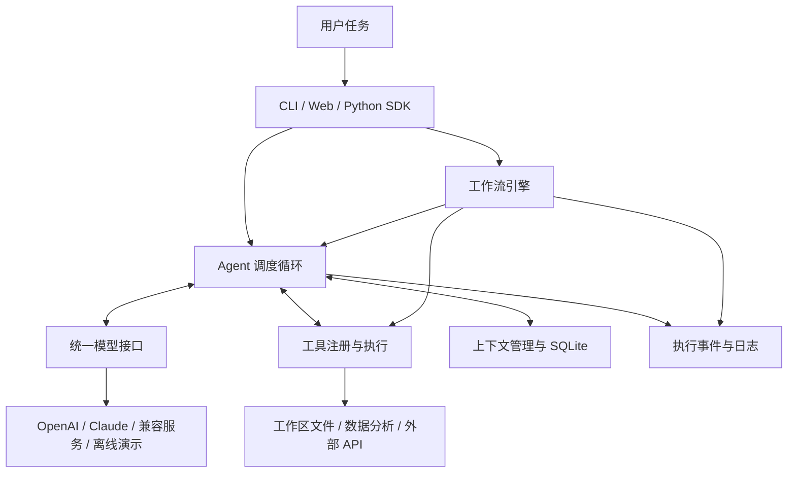

# yugan-agent 开发计划与实施记录

> 用户要求：根据参考图的功能规划，设计一个名为 **yugan-agent** 的 Agent 项目。
> 本文原为交给 Sol 的开发计划。用户随后要求下载 GitHub 上的 Cai_Agent 仓库，并以该仓库为基础实施本计划。参考图中的功能是需求参考，不要求复制 Cai-Agent 的品牌或宣传设计。
> 编写日期：2026-10-12。

## 2026-10-12 实施方式

- 上游已从 `https://github.com/caizizhen/Cai_Agent` 克隆，基线提交 `d7155a7643d07f6c71c1083011df063d3dccd89b`，本地分支 `yugan-plan`，Git 历史保留。
- 上游是大型终端编程 Agent，保留在本仓库的 `yugan-agent/` 和其他原有目录；计划中的轻量通用框架位于新增的 `src/yugan_agent/`，以根目录 `pyproject.toml` 为默认安装入口。
- 旧的未验证初稿已备份至 `C:\Users\yugan\Desktop\yugan-agent-draft-20261012`，新增框架以该初稿为起点继续实施。
- Web“工作流”页已改为可填写多步电脑任务的执行入口：每步调用 Agent，沿用同一会话；运行按钮旁可在发任务前选择逐项确认或仅本次自动批准。农业数据流程保留为 CLI/API 示例。
- 实际完成状态与测试结果以 README 为准，不要把计划阶段视作已交付功能。

## 0. 历史交接状态（初稿阶段）

在正式克隆上游之前，助手把“写计划”误解成了“直接实现”，曾在以下目录创建部分初稿：

```text
C:\Users\yugan\Desktop\yugan-agent
```

已有内容：

- `pyproject.toml`、`.env.example`、简略 `README.md`。
- `src/yugan_agent/` 下的 Agent、工具、模型适配、记忆、工作流、CLI、API 初稿。
- 内置农业示例工作流和 `workspace/` 示例数据。
- `.venv/` 已安装开发依赖；安装使用项目内 `.uv-cache/`。

**以上是初稿时的状态。** 浏览器页、测试、文档、CI 与打包验证现已补齐；真实模型在线验证仍未完成。最新结果见根目录 `README.md` 和执行记录。

后续维护应检查实际实现和测试结果。本文中的功能对照是目标，不能单凭计划断定某项能力已经验证。

本地环境：

- Windows / PowerShell，Python：`D:\Python\python.exe`，当前检查为 Python 3.13。
- uv：`C:\Users\yugan\.local\bin\uv.exe`。
- 项目目标兼容 Python 3.11+。
- 默认服务端口 **8020**，避开用户原定本地 RAG 端口 8010。
- 用户记录中的 `D:\portfolio\RAG` 在本次检查中不存在；RAG 不能作为项目启动依赖。
- 不修改 CC Switch 配置，不将 `PROXY_MANAGED` 判断为损坏的密钥。

## 1. 项目定位

**一句话：一个用 Python 编写的轻量、模块化、可扩展 Agent 框架，支持接入模型、调用工具、执行工作流和管理会话记忆。**

优先服务三个目标：

1. 用户能够直接运行，理解“用户提出任务 → 模型选择工具 → 执行 → 反馈 → 回答”的过程。
2. 用户能够通过添加一个 Python 函数扩展能力，例如接入传感器数据、自己的 API。
3. 项目可作为嵌入式 / 物联网方向作品集中的 Python 配套项目，具有清楚的架构和可复现的演示。

第一版以本地单用户使用为范围。提供工程基础，但不宣称已经达到生产环境或企业级成熟度。

## 2. 参考图功能对照

| 参考图内容 | yugan-agent 对应设计 | 交付阶段 |
|---|---|---|
| Agent 自主规划与决策 | 模型根据任务选择工具，读取结果后继续执行，直至完成或触及上限 | 第一版 |
| 多轮对话与推理 | 同一 session 保留历史，支持连续追问；展示简短计划和执行记录 | 第一版 |
| 支持多种大模型 | 统一接口，接入 OpenAI、Claude、OpenAI 兼容服务；提供 Qwen / GLM 配置示例 | 第一版 |
| 内置常用工具 | 计算、时间、文件读取、文件列表、数值统计、CSV 分析、受限 HTTP GET | 第一版 |
| 受限文件创建 | 在 workspace 新建文本/数据文件，禁止覆盖并逐次确认 | 用户新增目标 / 首个安全基础版 |
| Windows 电脑操作 | 窗口枚举、固定应用/网址启动、窗口聚焦、输入文字和有限快捷键；本地逐次确认 | 用户新增目标 / 首个安全基础版 |
| 自定义扩展工具 | `@tool` 装饰器、类型标注生成参数结构、工具注册中心 | 第一版 |
| 集成第三方 API | 固定端点的 HTTP 工具与自定义 API 工具示例 | 第一版 |
| 灵活编排工作流 | JSON 定义步骤，支持工具、状态更新、条件判断、Agent 节点 | 第一版 |
| 条件分支与循环 | 条件满足走不同路径，跳转形成循环，设置最大执行步数 | 第一版 |
| 可视化流程（可选） | 输出 Mermaid 流程图，页面展示执行轨迹；拖拽编辑后续再做 | 第一版 / 后续 |
| 会话记忆管理 | SQLite 持久化、会话隔离、历史查询、会话删除 | 第一版 |
| 全局状态维护 | 每次工作流运行共享状态；每个会话有持久状态，避免不同用户相互污染 | 第一版 |
| 上下文窗口优化 | 按完整对话轮次裁剪输入，保留工具调用与结果配对，原始记录留库 | 第一版 |
| 轻量高效 | Asyncio 异步调用；不过早引入重量级 Agent 框架和分布式组件 | 全程 |
| 强扩展性 | Agent、Tool、Provider、Memory、Workflow 分层；提供自定义示例 | 第一版 |
| 日志追踪、错误处理、配置管理 | run_id、结构化事件、统一错误、超时与有限重试、环境变量配置 | 第一版 |
| 智能助手 | CLI 多轮聊天及浏览器任务入口 | 第一版 |
| 自动化工作流 | 农业数据巡检示例，展示条件判断与循环 | 第一版 |
| IDE / CLI / Web 集成 | Python SDK + CLI + FastAPI，附 IDE 调用示例；不要求做独立 IDE 插件 | 第一版 |
| 数据处理与分析 | 数值统计、CSV 列分析、基于工具输出的解释 | 第一版 |
| Python / Asyncio / Pydantic / OpenAI API / Rich | 使用对应技术完成核心实现 | 第一版 |
| 自定义工具生态 | 文档、示例、工具注册规范 | 第一版 |
| 插件市场（规划中） | 在路线图中定义插件元数据、安装与信任机制，暂不搭交易或发布平台 | 后续 |
| 社区驱动 | MIT 许可证、贡献指南、Issue / PR 模板、测试规范 | 第一版 |
| 开源、持续迭代 | 准备可公开的仓库内容；发布到 GitHub / Gitee 由用户决定 | 第一版准备 |

“自主规划”依赖真实模型能力；离线演示只验证程序流程，必须明确标为演示，不能冒充自然语言智能体。

## 3. 技术选型与架构

| 层次 | 方案 | 作用 |
|---|---|---|
| 运行环境 | Python 3.11+、uv、项目独立 `.venv` | 保证安装可复现，不污染其他 Python 项目 |
| 数据校验 | Pydantic / pydantic-settings | 校验工具参数、配置与工作流文件 |
| 异步调度 | Asyncio | 等待模型、API 时不阻塞整个服务 |
| 模型适配 | 官方 OpenAI / Anthropic SDK | 处理不同供应商的消息格式与工具调用 |
| HTTP 客户端 | httpx | 调用配置好的外部只读接口 |
| 记忆存储 | SQLite；抽象 MemoryStore 接口 | 本地保存会话，后续可替换存储实现 |
| 命令行 | argparse + Rich | 执行任务、交互聊天、打印轨迹 |
| Web/API | FastAPI + 简单 HTML/CSS/JS | 浏览器演示与外部程序集成 |
| 测试 | pytest + pytest-asyncio、HTTP Mock | 无真实 Key 也能测试主流程 |
| 质量与 CI | Ruff + GitHub Actions | 自动检查格式、逻辑测试与安装 |

第一版无需 React、Redis、MySQL、向量库和 Docker 集群。Web 层保持薄，核心能力能脱离网页单独使用。



## 4. 四个核心模块的实现要求

### 4.1 Agent

基本执行流程：

1. 读取 session 的历史和状态。
2. 加入用户任务，整理本轮可用上下文和工具说明。
3. 请求模型；返回普通文本则结束，返回工具调用则执行工具。
4. 把工具成功或失败结果交回模型，允许其调整下一步。
5. 达到完成条件、最大模型轮数、最大工具次数或超时后停止。
6. 保存会话与执行事件，返回 `completed / limited / error` 状态。

具体要求：

- `Agent.run(prompt, session_id)` 为公共调用入口，返回答案、状态、run_id、执行事件。
- 同一会话的并发请求串行处理；不同会话互不串线。
- 模型不输出工具结果时，不能编造“操作成功”。
- 支持自定义系统提示词；计划仅展示简短步骤，不要求暴露模型内部推理。
- 限制循环、调用数量、单次工具耗时和模型总等待时间。
- 明确取消执行后的记录与状态行为，不自动重试有副作用的工具。

### 4.2 Tools

建议公开接口：

```python
@tool
def add(a: int, b: int) -> int:
    """返回两个整数之和。"""
    return a + b

registry.register(add)
```

要求：

- 根据函数参数类型生成 JSON Schema，也就是让模型知道“这个工具需要哪些参数”。
- 执行前使用 Pydantic 校验，未知工具、缺参数和参数类型错误返回明确失败结果。
- 同时支持同步和异步函数；有副作用的工具必须显式声明并通过配置允许。
- 工具输入和返回内容有大小限制，避免无限文件或网络响应耗尽内存。
- 文件仅可读取指定工作区；检查 `..`、绝对路径、链接跳出目录和隐藏敏感文件。
- HTTP 工具只调用预先配置的可信端点，不允许模型任意指定 URL 或跟随重定向。
- 计算器解析有限算术表达式，不使用 `eval` 执行任意代码。
- 第一版不内置任意 shell 执行、任意文件删除或真实硬件控制工具。
- Windows 桌面操作仅通过窄接口提供；每次请求在 Web 本机弹窗确认，确认超时或拒绝即停止整轮任务。
- 桌面输入必须指定窗口标题；网址仅允许 HTTP/HTTPS；应用名与快捷键来自内置白名单。
- 不把任意命令执行、截图视觉理解或真实硬件控制伪装成已交付能力；坐标鼠标点击仅作用于主屏幕且逐次确认。

### 4.3 Workflow

节点类型：

- `tool`：调用指定工具，并把输出放入状态。
- `set`：设置或更新状态。
- `condition`：比较状态值，选择下一节点。
- `agent`：让 Agent 处理一个子任务，并存下答案。

要求：

- 一个 JSON 文件描述流程；启动前校验节点 ID、入口与跳转目标。
- 用引用结构读取状态，例如 `{"$ref": "temperature_stats.mean"}`。
- 仅支持清晰、受限的表达式，不执行用户传入的 Python 代码。
- 循环由跳转形成，必须设置最大执行步数。
- 每一步记录节点、结果状态与耗时；失败时保留已完成的轨迹。
- 输出 Mermaid 图用于文档或页面展示。
- 第一版不要求断点恢复、分布式任务调度或可视化拖拽编辑器。

### 4.4 Context / Memory

区分三种数据：

1. **对话历史**：用户、模型、工具之间的消息。
2. **会话状态**：应用主动保存的结构化数据，例如当前任务设置。
3. **工作流状态**：本次流程各节点共享的中间结果。

要求：

- SQLite 保存会话历史和状态，重启之后能继续同一会话。
- 提供查看、列出和删除会话的 API / CLI 入口。
- 裁剪模型输入时按完整轮次处理，不能让工具结果失去对应的工具调用。
- 裁剪只影响发送给模型的内容，不删除数据库原文。
- 第一版使用字符预算的保守策略，并明确它不是精确 Token 计数。
- 当前一轮自身已超预算时应提示拆分任务，不偷偷截断工具参数。
- 提供可替换的存储接口；自动摘要、向量检索与跨会话长期记忆后续再做。

## 5. 多模型接入约定

统一模型接口建议为：

```python
async def complete(messages, tools) -> Message: ...
async def close() -> None: ...
```

| 模式 | 接口 | 使用方式 |
|---|---|---|
| `mock` | 本地确定性演示 | 默认模式，无 Key、无网络请求、无模型费用 |
| `openai` | Responses API | 使用官方协议完成工具调用和结果回传 |
| `compatible` | Chat Completions | 接入支持该协议的 Qwen、GLM、代理或本地模型服务 |
| `anthropic` | Messages API | 使用 Claude 原生工具调用格式 |

注意：

- 模型 ID、Key、Base URL 从 `.env` 或环境变量读取，不硬编码真实凭据。
- 接口兼容不代表所有模型均支持工具调用；文档写明需要选择支持工具的模型。
- 不自动读取用户其他应用的 Key，也不擅自修改代理设置。
- 不同供应商原始消息格式应隔离，保留协议要求回传的块和调用 ID。
- 超时、鉴权失败、限流、响应截断应区分处理；不能将截断输出算作任务完成。
- 为每个协议编写模拟 HTTP 响应测试；真实模型测试需要用户配置可用 Key。
- 开发时核对官方文档，避免依据旧教程固定最新模型名称。

参考资料：

- [OpenAI 工具调用](https://developers.openai.com/api/docs/guides/function-calling)
- [Claude 工具调用与结果回传](https://platform.claude.com/docs/en/agents-and-tools/tool-use/handle-tool-calls)
- [阿里云百炼接口地址](https://help.aliyun.com/zh/model-studio/base-url)

## 6. 用户入口与演示

### CLI

计划提供下列命令；Sol 应使实际命令与最终 README 一致：

```powershell
python -m yugan_agent demo
python -m yugan_agent run "计算 (12 + 8) * 3" --session demo
python -m yugan_agent chat --session learning
python -m yugan_agent tools
python -m yugan_agent history
python -m yugan_agent workflow demo
python -m yugan_agent workflow demo --graph
python -m yugan_agent serve --port 8020
```

### Web 操作页

做一个简单、清楚的中文页面，无需照抄参考海报。可参考其深色、蓝紫色风格，优先保证可操作。

- **任务页**：输入任务、查看回答与工具执行记录、显示当前模型和演示标识。
- **工具页**：查看可用工具和参数说明。
- **工作流页**：运行内置流程、查看分支选择、状态与执行轨迹。
- **会话页**：新建 / 切换会话、查看历史与状态、删除会话。
- 请求中禁用重复提交；错误、超时、空结果有明确提示。
- 模型和工具输出当作文本显示，不能直接作为 HTML 插入页面。
- 默认监听 `127.0.0.1:8020`；对外监听要求配置 API 令牌。

### 三个必备示例

1. **工具型助手**：自然语言计算或读取工作区文件，展示工具调用与结果回传。
2. **农业数据分析**：分析示例 CSV 的温度、湿度或土壤湿度；数值结果由工具计算，模型负责解释。
3. **农业巡检工作流**：读取示例数据 → 计算统计值 → 比较阈值 → 分支输出建议 → 有界循环示例 → 报告。

数据必须标为虚构示例。工作流仅给出建议，不声称实际启动风扇、水泵或读取了真实 STM32 设备。

后续物联网扩展可以增加 MQTT、串口、RAG 工具；发布控制指令属于有副作用操作，需要单独设计允许范围、模拟模式与操作记录。

## 7. 建议目录

```text
yugan-agent/
├── PLAN.md                      # 本开发计划
├── README.md                    # 中文快速开始与项目介绍
├── pyproject.toml               # 依赖、打包、CLI 入口
├── uv.lock                      # 可复现的依赖版本
├── .env.example                 # 无密钥的配置模板
├── .gitignore
├── LICENSE
├── CONTRIBUTING.md
├── src/yugan_agent/
│   ├── __init__.py
│   ├── __main__.py
│   ├── config.py
│   ├── models.py
│   ├── agent.py
│   ├── providers.py             # 变复杂后可拆为 providers/ 包
│   ├── tools.py
│   ├── builtins.py
│   ├── memory.py
│   ├── workflow.py
│   ├── runtime.py
│   ├── cli.py
│   ├── api.py
│   ├── data/greenhouse.json
│   └── web/                    # 可随安装包发布的静态页面
├── examples/
│   ├── custom_tool.py
│   ├── custom_agent.py
│   ├── custom_provider.py
│   ├── custom_memory.py
│   └── api_client.py
├── workspace/                  # 允许工具读取的演示数据
├── tests/
├── docs/
│   ├── architecture.md
│   ├── providers.md
│   ├── tools.md
│   ├── workflows.md
│   └── roadmap.md
└── .github/
    ├── workflows/ci.yml
    ├── ISSUE_TEMPLATE/
    └── pull_request_template.md
```

`.venv/`、`.uv-cache/`、`.env`、运行日志、SQLite 数据库不进入 Git；示例数据和锁文件进入 Git。

## 8. 按阶段执行

### 阶段 0：核查初稿

- 阅读项目范围内的规范与本计划。
- 检查现有模块的输入输出、缺失页面、未完成逻辑和依赖设置。
- 输出简短差距清单，再实施修复；不把“有文件”当成“功能完成”。
- 验收：安装方式与运行入口明确，确认接下来保留或修改哪些结构。

### 阶段 1：打通离线闭环

- 完成统一消息结构、工具注册、参数校验、MockProvider 和 Agent 循环。
- 提供计算和时间工具，接入 CLI。
- 验收：无 Key 环境运行 demo，能看到调用真实 Python 工具得到的结果；明确标记离线演示。

### 阶段 2：上下文与持久化

- 完成 SQLite、会话状态、历史查询、上下文裁剪、会话并发保护。
- 验收：重启之后历史仍在；不同 session 隔离；裁剪后工具消息配对有效。

### 阶段 3：真实模型与工具扩展

- 完成三种协议适配及错误处理，补齐文件、CSV、数值统计和 HTTP 工具。
- 添加 Qwen / GLM / Claude / OpenAI 配置说明和自定义工具示例。
- 验收：模拟 HTTP 测试覆盖“请求 → 工具调用 → 工具结果 → 最终回答”；有 Key 时补真实冒烟测试。
- 没有 Key 可以完成实现和模拟测试，但交付说明必须写“真实模型未验证”。

### 阶段 4：工作流

- 实现四种节点、状态引用、分支、循环上限、输入校验与执行记录。
- 完成农业巡检演示，输出流程图。
- 验收：高温与正常温度分别进入不同分支；循环按预期结束；错误节点返回定位信息。

### 阶段 5：API 与浏览器操作页

- 补齐页面、API、鉴权、请求大小限制、任务进行中状态和错误反馈。
- 验收：浏览器可以聊天、运行工作流和切换会话；页面刷新后会话可恢复。
- 浏览器实测操作一次，不能只确认 HTML 文件存在。

### 阶段 6：工程质量与交付

- 完成单元 / 集成测试、格式检查、CI、锁文件、打包检查。
- 补齐中文文档、扩展示例、许可证、贡献说明和后续路线图。
- 在干净虚拟环境安装构建后的包，验证 CLI、静态页面和内置数据都包含在包内。
- 验收：README 中的快速开始可复现；测试通过；交付说明如实列出未验证的外部能力。

## 9. 测试与最终验收清单

必须覆盖真实风险，而不是只测试函数存在：

- [ ] 工具参数缺失、类型错误、未知工具、工具超时和工具异常。
- [ ] 文件路径越界、绝对路径、符号链接 / Windows 目录链接边界。
- [ ] 计算器拒绝代码执行与过大计算，CSV 拒绝无效数据。
- [ ] 模型连续调用工具、多工具结果回传、无效 JSON、响应截断。
- [ ] OpenAI Responses 的原始输出块回传，Claude 的 tool_result 排列。
- [ ] API 错误不泄露 Key、鉴权头、完整供应商异常或私有配置。
- [ ] Agent 达到上限时标记未完成，不冒充成功。
- [ ] 上下文裁剪保留完整工具交互，超长当前轮次给出明确提示。
- [ ] 会话重启恢复、隔离、同会话并发及删除行为。
- [ ] 工作流两个条件分支、循环退出、死循环上限、坏引用和失败节点。
- [ ] API 鉴权、跨源请求限制、输入校验与请求体大小限制。
- [ ] 页面可以完整操作，无模型输出导致的脚本注入。
- [ ] 干净安装后 CLI、Web 静态资源和内置演示数据正常工作。
- [ ] 测试默认不访问付费模型，不依赖外部网络或用户本地服务。

交付时给用户：

1. 项目绝对路径。
2. 已实现功能与参考图对照。
3. 三条以内的首次启动命令。
4. `.env` 的配置位置和模型切换示例。
5. 实际运行过的测试与结果。
6. 已知限制、真实模型验证状态及后续迭代入口。

## 10. 后续路线图

- **当前用户新增目标：Windows 桌面 Agent 安全基础版**——代码已实现窗口标题读取、固定应用/网页打开、窗口切换、文本输入、有限快捷键和主屏幕坐标单击；每项操作由 Web 前端逐次确认。需要重启用户桌面服务后手工验收。文件夹授权、截图/视觉理解与通用命令仍需单独设计与实现。

- **v0.2：物联网集成**——MQTT / 串口适配，先模拟再连接硬件，完善有副作用工具的确认与审计。
- **v0.3：知识与记忆**——可选 RAG 适配、摘要、精确 Token 预算；不绑定用户旧服务的未知接口。
- **v0.4：插件生态**——插件清单格式、版本兼容、显式安装和启用；先做本地插件目录，再考虑市场。
- **更后续：部署与协作**——流式输出、后台任务、工作流恢复、多用户权限、部署说明与监控。

这些属于规划，不得在第一版 README 中描述为已经完成的能力。

## 后续维护指令

> 维护 yugan-agent 时，先阅读根目录 `README.md` 与 `UPSTREAM.md`，按本计划的功能对照和验收清单核查实际实现。默认演示模式不需要 Key；真实模型必须使用用户显式配置的接口和密钥，不读取其他应用的配置。区分第一版与路线图，不擅自发布远端仓库或控制真实硬件。用中文报告关键文件、测试结果和未验证项。
